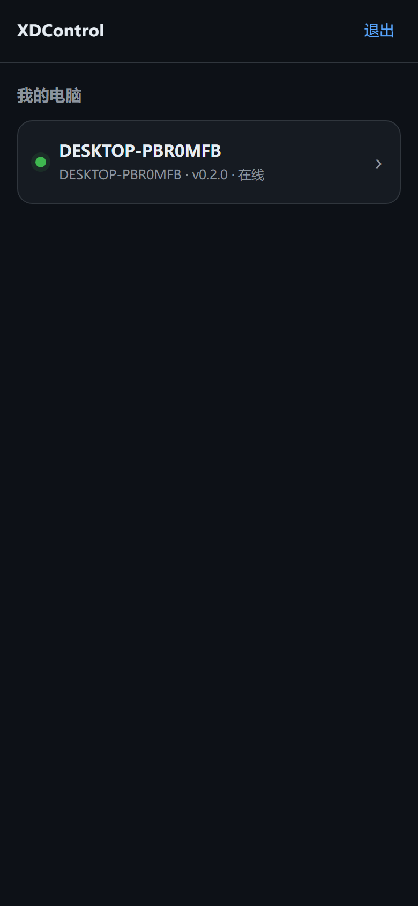
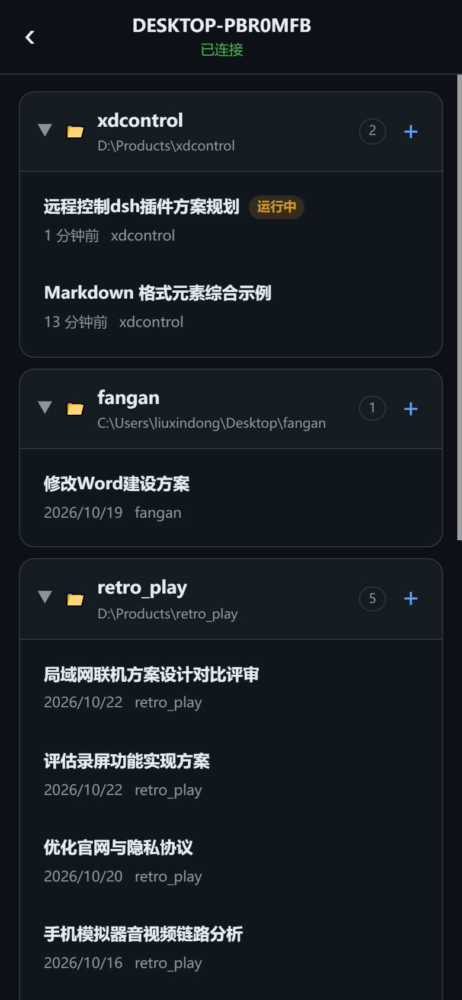
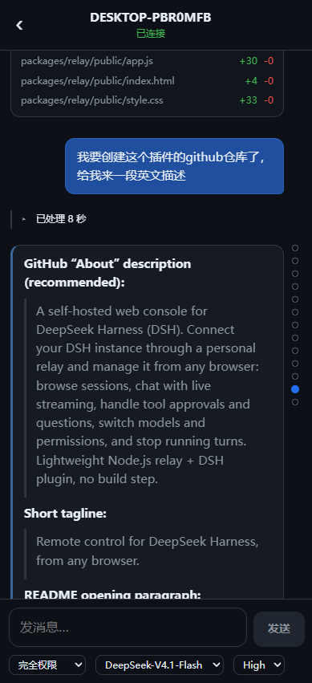

# DSH Web Control

用浏览器通过自己的中继服务器远程使用 DSH：选择电脑、按工作区看会话、直接新建对话、继续聊、停止回合。

v0.2 面向个人自用：中继走普通 HTTP，浏览器用「用户名 + 密码」登录，没有端到端加密。请只在你信任的网络中使用，并设置强密码。





## 功能

- PC 插件主动出站连接中继，不需要公网 IP、端口映射或 VPN；
- 在浏览器里按 DSH 工作区分组展示会话树，可展开/收起；
- 新建对话从工作区行右侧的「+」进入，会话挂到对应工作区；
- 空白会话（新建后没有发过消息）不显示，发第一条消息后才出现；
- 助手回复支持 Markdown（标题、列表、粗体/斜体、引用、代码块、表格、链接）；
- 按轮折叠工具调用和思考过程（「处理过程」），助手回复保持可见；显示每轮编辑过的文件列表；支持工具确认卡片、`ask_user_question` 问答与提交答案；新建会话可选权限（只读 / 工作区可写 / 完全权限）、模型和思考级别，当前会话也能切换；Hash 路由支持刷新恢复、深链接和浏览器前进/后退；支持停止回合；
- 中继不保存对话内容，只负责配对、实例列表和消息转发。

## 文档

| 文档 | 内容 |
|---|---|
| [安装插件](docs/INSTALL.md) | 在 DSH 中安装、启用、更新、卸载 |
| [部署中继](docs/DEPLOY.md) | 本地运行、云服务器 systemd/Docker、环境变量、安全、故障排查 |
| [使用说明](docs/USAGE.md) | PC 配置、浏览器操作、工作区树、Markdown、常见问题 |
| [设计记录](docs/PLAN.md) | 早期完整方案（审批、推送、E2E 等未实现部分） |

## 架构

```text
浏览器 ──HTTP/WS──► 中继（云服务器，默认 7801）
                              ▲
                              │ PC 主动出站 WSS
                              │
                     Windows PC：DSH Desktop + DSH Web Control 插件
```

- 中继只需要一个 Node 进程和一个固定端口，不需要数据库；
- PC 插件只发起出站连接；
- 多台 PC 可以连接同一个中继，浏览器实例列表会显示多张卡片。

## 快速开始

### 1. 启动中继

本机测试：

```powershell
cd packages\relay
npm ci
notepad config.json
node server.js
```

在 `config.json` 里设置端口、登录用户名/密码、登录有效期和可选的插件令牌；默认监听 `0.0.0.0:7801`，浏览器页面 `http://<中继IP>:7801/`。各字段（host / port / username / password / sessionSecret / sessionTtlDays / pluginToken）的含义、默认值和加载行为见 [DEPLOY.md](docs/DEPLOY.md#配置文件推荐)。

不想用配置文件时也可以用环境变量：`DSWC_PASSWORD='...' node server.js`（PowerShell 用 `$env:DSWC_PASSWORD = '...'`）。配置文件里写过的字段优先于环境变量。云服务器部署（systemd、Docker、防火墙、HTTPS 说明）见 [DEPLOY.md](docs/DEPLOY.md)。

### 2. 安装插件

打开 DSH 左侧 **插件** → **添加插件** → 选择本仓库的 `packages/plugin` 目录，然后启用 **DSH Web Control 远程控制**。插件没有 npm 依赖，也不需要构建。

详细步骤和更新/卸载见 [INSTALL.md](docs/INSTALL.md)。

### 3. 配置 PC

在 **插件 → DSH Web Control 远程控制** 页面底部填写：

- 中继服务器：云服务器 IP 或域名；
- 端口：默认 `7801`；
- 电脑名称：按需；
- 插件令牌：仅当服务器设置了插件令牌时填写。

点 **保存并连接**。也可以用：

```text
/webctl 1.2.3.4:7801
```

### 4. 浏览器使用

1. 打开 `http://<中继IP>:7801/`，用 `admin` / 你设置的密码登录；
2. 点在线电脑，进入工作区会话树；
3. 点工作区右侧「+」新建对话；
4. 输入消息，发送；需要时点「停止」。

浏览器端操作细节和常见问题见 [USAGE.md](docs/USAGE.md)。

## 从 XDControl 改名

插件、仓库和工作区目录都从 `xdcontrol` 改成了 `dsh-web-control`（当前目录 `D:\Products\dsh-web-control`）。对照表：

| 旧 | 新 |
|---|---|
| 插件包 `@local/dsh-xdcontrol`，插件 id `xdcontrol` | `@local/dsh-web-control`，id `dsh-web-control` |
| 插件名「XDControl 远程控制」 | 「DSH Web Control 远程控制」 |
| 快捷命令 `/xdcontrol` | `/webctl` |
| 配置 `$DSH_HOME/xdcontrol.json` | `$DSH_HOME/dsh-web-control.json`（自动迁移，旧文件保留） |
| 中继配置 `XDCTL_*` 环境变量 | `config.json`（推荐）或 `DSWC_*` 环境变量 |
| 中继包 / systemd 单元 `xdcontrol-relay` | `dsh-web-control-relay` |
| 会话 Cookie `xd_session` | `dswc_session`（浏览器端需重新登录一次） |

中继已经在运行的话，按 [DEPLOY.md](docs/DEPLOY.md#从-xdcontrol-改名前升级) 里的一次性搬迁步骤处理。

## 安全

- **必须修改默认密码**：在 `packages/relay/config.json` 里设置强 `password`（或环境变量 `DSWC_PASSWORD`）；
- 建议设置 `sessionSecret`（或 `DSWC_SECRET`），让浏览器登录状态跨重启保留；
- 登录有效期默认 30 天，可以用 `sessionTtlDays`（或 `DSWC_SESSION_TTL_DAYS`）调整；调小不会立即让已登录设备掉线，若要让所有设备立即重新登录，请修改 `sessionSecret`；
- 如非必要不要裸暴露 7801；优先 VPN、防火墙白名单或内网；
- 可设置 `pluginToken`（或 `DSWC_PLUGIN_TOKEN`），并在 PC 插件设置里填同一个值；
- `config.json` 默认是占位密码 `change-me`：部署时改成强密码，建议权限设为 `600`；真实密码不要提交到公开仓库；
- 远程会话的权限由你选择的预设决定；选择「完全权限」时 Agent 可以执行任意命令、读写任意文件，持有登录状态的设备丢失等同于电脑控制权丢失；
- 不用时关闭插件里的「启用远程控制」或执行 `/webctl off`。

中继和浏览器页面是 HTTP 明文；v0.2 的 PC 插件也只用 `ws://`。在补 `wss` 之前，最稳妥的是用 WireGuard/Tailscale 等 VPN 保护链路。

## 已知限制

- 没有审批卡片：远程权限由预设决定（只读 / 工作区可写 / 完全权限），完全权限下如果某个工具仍然请求审批，会按 `never` 策略被拒绝；
- 没有推送通知，需要保持页面打开；
- 没有图片/文件上传、端到端加密；
- 中继没有数据库，重启后实例列表需要 PC 重新连接；
- 页面通过 HTTP 访问时不能作为 PWA 安装。

## 开发

```bash
# 中继
cd packages/relay
npm ci
node server.js          # 配置在 config.json

# 端到端探测：登录、实例、建会话、发消息、事件
node scripts/probe.mjs

# 只读检查工作区分组
node scripts/tree-probe.mjs

# 验证空白会话不会出现在列表
node scripts/blank-probe.mjs

# 页面截图冒烟（需要先启动 Edge 的 CDP，见脚本顶部说明）
node scripts/ui-smoke.mjs
```

插件修改后：

- `packages/plugin/index.js`：在 **插件** 页禁用/启用一次，或重启 DSH；
- `packages/plugin/client.js`：刷新 DSH 页面；
- 页面：刷新浏览器。

## 目录

```text
packages/plugin/       DSH 插件（Host + Client 设置页）
packages/relay/        中继服务 + Web 页面（config.json 是中继配置）
packages/relay/public/ Web UI、Markdown 依赖
deploy/                systemd / Docker / env 示例
docs/                  安装、部署、使用、设计文档
```
