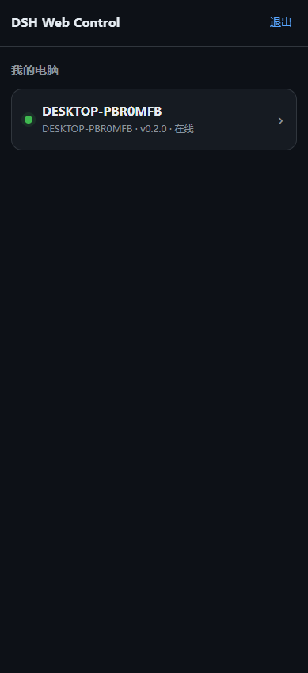
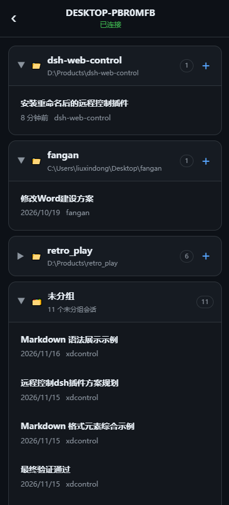
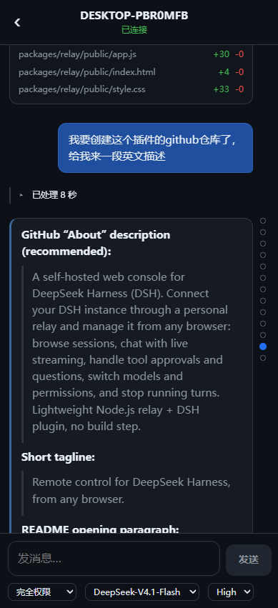

# 使用说明

本文覆盖 PC 端配置、浏览器端操作和常见问题。安装见 [INSTALL.md](INSTALL.md)，中继部署见 [DEPLOY.md](DEPLOY.md)。

## PC 端：配置中继

1. 打开 DSH 左侧的 **插件**；
2. 在「已安装插件」里点 **DSH Web Control 远程控制**；
3. 滚动到页面底部的 **DSH Web Control 连接设置**；
4. 可以保存多个中继配置；每个配置填写名称、中继服务器、端口和令牌；
5. 用单选按钮选择「当前使用」的那一个，点 **保存并连接**。

| 字段 | 说明 |
|---|---|
| 启用远程控制 | 总开关；关闭后插件不连接任何中继 |
| 配置名称 | 仅用于区分，例如「本地调试」「云中继」 |
| 中继服务器 | 云服务器 IP 或域名，例如 `1.2.3.4` |
| 端口 | 默认 `7801` |
| 插件令牌 | 可选，与当前中继配置里的插件令牌一致（`config.json` 的 `pluginToken` 或 `DSWC_PLUGIN_TOKEN`） |
| 当前使用 | 单选；同一时间只连接这一个中继 |
| 电脑名称 | 显示在中继页面上的名字；留空使用主机名；所有中继共用 |
| 默认目录（不选工作区时） | 只有在没有任何工作区时，新建默认对话才使用；所有中继共用 |

保存后立即重连，不需要重启 DSH。状态行会显示：

- **已连接：<配置名称> · inst_xxx**：正常；
- **未连接，请检查当前中继的地址和端口**：中继没启动、地址/端口不对、防火墙没放行，或令牌不一致；
- **远程控制已关闭**：取消勾选了「启用远程控制」。

旧版的单中继配置会自动变成一个名为「默认中继」的配置。

也可以用 DSH 对话里的命令：

```text
/webctl 1.2.3.4:7801       修改当前中继并连接
/webctl use 云中继          切换到指定中继（名称或 ID）
/webctl status             查看当前中继和全部配置
/webctl cwd D:\Projects\demo
/webctl token <令牌>       设置当前中继的插件令牌
/webctl off
```

配置保存在 `$DSH_HOME/dsh-web-control.json`。

### 多中继配置

- 默认有一个「默认中继」配置；旧版单中继配置会自动迁移成这一个；
- 点「添加中继」可以增加多个配置，分别填写名称、地址、端口和令牌；
- 每张配置卡片左侧的单选按钮决定「当前使用」；插件同一时间只连接选中的那个；
- 切换后点「保存并连接」，插件会先断开旧中继，再连接新中继；
- `/webctl status` 会用 `*` 标出当前使用的中继。

## 浏览器端：登录与选电脑

1. 浏览器打开 `http://<中继IP>:7801/`；
2. 输入用户名/密码（默认用户 `admin`，密码由中继的 `config.json` 的 `password` 或环境变量 `DSWC_PASSWORD` 决定）；
3. 看到在线的电脑卡片，点进去。

登录有效期默认 **30 天**，由中继 `config.json` 的 `sessionTtlDays`（或环境变量 `DSWC_SESSION_TTL_DAYS`）控制；到期后需要重新登录。调小这个值不会让已经登录的浏览器立刻掉线，旧 Cookie 仍按原来的过期时间有效。



## 浏览器端：工作区会话树

进入电脑后，会话按 DSH 工作区分组：



- 每个工作区显示名称、路径、会话数量和右侧的 **+**；
- 点工作区行展开/收起；
- 有会话的工作区默认展开；
- 不属于任何工作区的会话收在「未分组」；
- 空白会话（新建后没有发过消息）不会显示，也不会计入数量。

### 新建对话

- 点工作区右侧的 **+**，打开新建会话弹窗；确认权限、模型和思考级别后在该工作区创建对话；
- 页面顶部不再有「新对话」按钮；
- 如果 DSH 里没有任何工作区，列表会显示「新建默认对话」按钮，使用插件设置里的默认目录；
- 新建后如果没有发送消息就返回，这个空白会话不会出现在列表里；发送第一条消息后才出现。

## 浏览器端：对话



- 底部输入框发送消息；
- 运行中时显示「停止」，可以中断当前回合；
- 助手回复支持 Markdown：标题、粗体/斜体、列表、引用、行内代码、代码块、表格、链接；
- 每一轮的工具调用和思考过程收在上方的「处理过程」里，默认折叠，点开可看参数和结果；
- 每一轮底部会列出这一轮编辑过的文件（路径和增删行数），超过 4 个可以展开；
- 页面右侧的小圆点可以快速跳到每一个提问，悬停可看问题内容；
- 打开较长对话时会加载最近的历史，列表顶部有「加载更早的消息」时继续向前翻；
- 底部显示当前模型、权限和思考级别；模型、权限和思考级别都可以切换。

新建会话时可以选择权限和模型：

- **权限**：
  - **只读**：只能读取文件，不能写入；
  - **工作区可写**：允许修改当前工作区内的文件（默认）；
  - **完全权限**：不限制命令和文件访问，风险最高；
- **模型**：按 provider 分组列出当前可用的模型（如 DeepSeek-V4.1-Flash、DeepSeek-V4-Pro）；
- **思考级别**：随所选模型的 `reasoning.efforts` 动态变化（例如 Low / High / Max，具体以模型实际提供的级别为准），模型没有思考级别时隐藏。

新建弹窗会记住你上次选择的权限、模型和思考级别；打开会话后，底部也会显示当前模型、权限和思考级别，可以随时切换，切换后对后续操作生效。

## 确认与提问

当工具需要你确认，或模型调用 `ask_user_question` 提问时，输入框上方会出现卡片：

- **工具确认**：显示工具名和原因，可以选择「允许一次」或「拒绝」；
- **提问**：
  - 单选、多选或只填自定义文本；
  - 多个问题会在同一张卡片里一起提交；
  - 没选的题会作为「跳过」提交；
  - 计划审阅会展示计划正文，再按选项确认；
- 卡片只发给当前打开的会话；刷新页面或重新连接后，未完成的卡片会再次出现；
- 是否触发确认取决于当前权限预设：只读/工作区可写下可能触发确认，完全权限通常不会。

远程点「允许一次」等同于坐在电脑前确认，操作前请确认工具名、参数和原因。

## 地址与刷新

页面使用 Hash 路由，地址栏可以直接看到当前位置：

```text
#/                                     设备列表
#/pc/<实例ID>                          某台电脑的会话列表
#/pc/<实例ID>/s/<会话ID>                某个对话
```

- 刷新页面会按当前地址恢复到同一台电脑/同一个对话；
- 可以收藏或分享地址（需要对方已登录，且电脑在线）；
- 浏览器前进/后退会在设备 → 会话列表 → 对话之间切换；
- 未登录时打开深链接，登录后会继续进入该地址；
- 电脑离线时会提示并回到设备列表；会话已归档/不存在时会回到该电脑的会话列表；
- Hash 不会发送给中继服务器，所以部署和反向代理不需要额外配置。

## 输入框与页面缩放

远程页面的输入框、文本域和下拉框都使用 **16px** 字号，避免部分浏览器（如 iOS Safari）在聚焦时自动放大页面。

如果更新后仍然放大：

1. 刷新页面，确认加载到最新 CSS；
2. 确认浏览器没有手动缩放；
3. 仍有问题，记录浏览器和操作系统版本反馈。

## 多台电脑

同一个中继可以连接多台 PC。浏览器实例列表会显示多张电脑卡片；点不同的卡片即可切换。每台电脑的配置里可以设置不同的「电脑名称」以便区分。

## 安全提醒

- 中继和浏览器页面是 **HTTP 明文**，登录密码和对话内容在网络上不加密；
- 远程会话的权限由预设决定：只读、工作区可写或完全权限；完全权限下 Agent 可以在电脑上执行任意命令、读写任意文件，登录设备丢失等于电脑控制权丢失；
- 建议：
  - 使用强密码（`config.json` 的 `password` 或 `DSWC_PASSWORD`）；
  - 设置插件令牌（`config.json` 的 `pluginToken` 或 `DSWC_PLUGIN_TOKEN`）并在 PC 上填同一个值；
  - 用 VPN / 防火墙限制 7801 的来源；
  - 给登录设备设置锁屏；
  - 不用时关闭「启用远程控制」或执行 `/webctl off`。

## 已知限制

- 工具审批和提问只在当前会话有浏览器连接时接管；没有浏览器连接时交给 PC 端的 DSH 处理。是否触发审批取决于权限预设，完全权限通常不会触发；
- 带自动继续的 `timed` 模式 `ask_user_question` 仍交给 PC 端处理，普通阻塞式提问支持远程回答；
- 没有推送通知，需要保持页面打开；
- 没有图片/文件上传、端到端加密；同一时间只查看一台电脑；
- 中继不保存对话，重启后实例列表需要 PC 重新连接；
- 当前没有 PWA manifest / Service Worker，不能安装为 PWA（与 HTTP/HTTPS 无关）。

## 常见问题

**浏览器打不开中继页面**

- 检查云服务器安全组/ufw 是否放行 7801；
- 本机测试时检查 Windows 防火墙；
- 确认中继打印的是 `0.0.0.0:7801`。

**登录失败**

- 用户名默认 `admin`，可以在中继的 `config.json` 里改 `username`；
- 密码是中继配置里的 `password`（或环境变量 `DSWC_PASSWORD`）；
- 中继重启且没有设置 `sessionSecret`（或 `DSWC_SECRET`）时，旧登录会失效，需要重新登录。
- 登录过期：默认 30 天，到期后会回到登录页；有效期由中继的 `sessionTtlDays` 控制。

**看不到电脑**

- PC 插件状态是否「已连接中继」；
- 中继地址/端口是否正确；
- 如果中继设置了插件令牌，PC 是否填了同一个值；
- 看中继日志有没有 `plugin connected`。

**电脑显示已离线**

- 中继或 PC 重启后实例 id 会变化；刷新页面重新选择电脑；
- 页面会自动回到实例列表，重新点进去即可。

**新建的对话没有出现**

- 新建后还没有发送消息：按设计不显示；
- 发送第一条消息后再返回列表，应该出现；
- 仍不出现时下拉刷新/重新打开页面。

**Markdown 没渲染**

- 刷新页面，确认 `/vendor/marked.umd.js` 和 `/vendor/purify.min.js` 能访问；
- 如果中继部署时漏拷了 `public/vendor`，会回退到纯文本渲染；重新拷贝 `public` 目录即可。

**页面顶部按不到「新对话」**

- v0.2 已去掉顶部按钮，统一从工作区行的 **+** 新建；没有工作区时使用「新建默认对话」。
